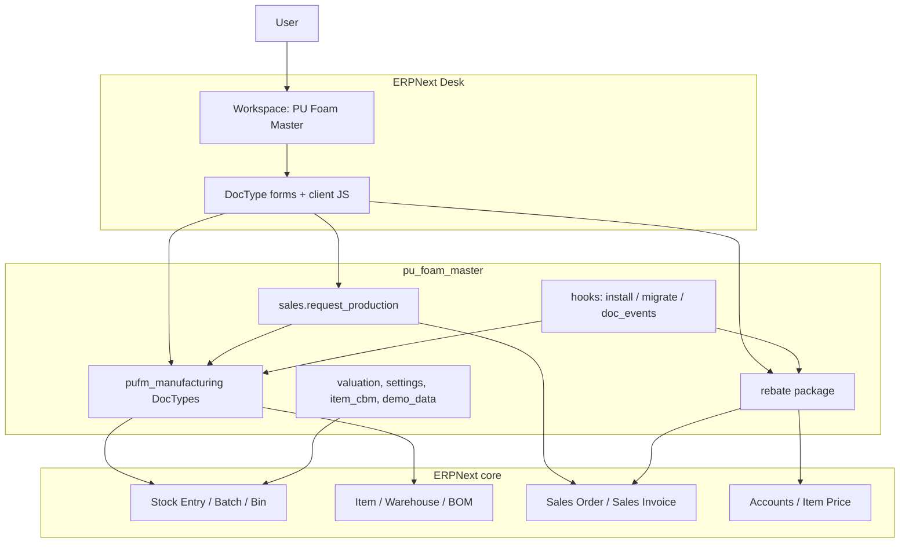

# PU Foam Master

**PU Foam Master** is a custom [Frappe](https://frappeframework.com/) / [ERPNext](https://erpnext.com/) application for polyurethane (PU) foam factories. It helps production, conversion, quilting, assembly, and commercial teams run virgin pour, block conversion, mattress assembly, rebound production, scrap costing, distributor rebates, and factory pricing on top of ERPNext stock and accounting.

| | |
|---|---|
| **Repository** | [github.com/Bright-CG/pu_foam_master](https://github.com/Bright-CG/pu_foam_master) |
| **App title (Desk)** | PU Foam Master |
| **Python / Frappe app name** | `pu_foam_master` |
| **Installable app directory** | `pu_foam_master/` (contains the Python package `pu_foam_master`) |
| **Frappe module** | `pufm_manufacturing` |
| **Declared version** | `0.0.1` |
| **License** | Proprietary source-available (view for evaluation; no redistribution or commercial use) |
| **Primary stack** | Frappe / ERPNext (documented operational target: **v15**) |

> This repository is the **custom app**. It expects an existing Frappe bench with ERPNext. It is not a standalone web framework project with its own `.env`, Docker Compose stack, or CI pipeline in-tree.

---

## Table of contents

1. [Product overview](#1-product-overview)
2. [The problem](#2-the-problem)
3. [The solution](#3-the-solution)
4. [Key features](#4-key-features)
5. [Product workflows](#5-product-workflows)
6. [Screenshots / demo](#6-screenshots--demo)
7. [Technology stack](#7-technology-stack)
8. [Architecture](#8-architecture)
9. [Important engineering decisions](#9-important-engineering-decisions)
10. [Domain model](#10-domain-model)
11. [Prerequisites](#11-prerequisites)
12. [Installation overview](#12-installation-overview)
13. [Pre-installation business setup](#13-pre-installation-business-setup)
14. [Local installation](#14-local-installation)
15. [First-time application setup](#15-first-time-application-setup)
16. [Production / VPS deployment](#16-production--vps-deployment)
17. [Configuration reference](#17-configuration-reference)
18. [Roles and permissions](#18-roles-and-permissions)
19. [Master data](#19-master-data)
20. [APIs](#20-apis)
21. [Testing](#21-testing)
22. [CI/CD](#22-cicd)
23. [Security considerations](#23-security-considerations)
24. [Troubleshooting](#24-troubleshooting)
25. [Maintenance](#25-maintenance)
26. [Backup and recovery](#26-backup-and-recovery)
27. [Known limitations](#27-known-limitations)
28. [Future improvements](#28-future-improvements)
29. [Project structure](#29-project-structure)
30. [Developer guide](#30-developer-guide)
31. [Contributing](#31-contributing)
32. [License](#32-license)
33. [What this project demonstrates](#33-what-this-project-demonstrates)
34. [Contact](#34-contact)

---

## 1. Product overview

PU Foam Master extends ERPNext so a foam factory can track the real shop-floor path from **chemical pour → foam blocks → cores / sheetings → quilted fabric → finished mattresses**, and can recycle scrap into **rebound** blocks. It also supports commercial operations that matter in this industry: **distributor rebate tiers**, **period rebate settlement**, a **price engine** that writes Item Prices, and a **stock matrix** for inventory visibility.

**Who it is for**

- Factory operators (block production, conversion, quilting, assembly, rebound)
- Production / plant managers
- Sales and finance teams handling distributor rebates and list pricing
- ERPNext administrators configuring warehouses, items, and accounts

**What users can accomplish**

- Define density recipes and run virgin production batches with density runs and produced blocks
- Issue Job Orders for mattress, quilting, or sheeting work, with workflow status driven by linked production documents
- Convert blocks into cores (and related outputs) with stock entries and scrap valuation
- Quilt fabric against Quilting Job Orders and assemble mattresses with consumable backflush
- Cost scrap and produce rebound foam
- Apply instant invoice rebates and settle period rebates for distributors
- Generate price matrices and monitor stock against reorder levels

---

## 2. The problem

A PU foam plant is not a simple “make → stock → sell” loop. Typical ERPNext manufacturing fits discrete BOMs well, but foam factories also need:

- **Recipe-driven virgin pour** with density configurations, chemical consumption, and block outputs
- **Multiple downstream paths** from the same blocks (mattress cores, furniture sheetings, quilting rolls)
- **Parallel mill streams** (for example quilting fabric while cores move to assembly)
- **Scrap economics** — scrap has both an input cost (rebound) and an output rate (when scrap is generated)
- **Mattress assembly rules** that depend on finish type (plain / fully quilted / side quilted), brand-allowed fabrics, dimensions, and consumables
- **Distributor commercial terms** (tiered rebates) that must post correctly into ERPNext invoices and credit notes
- **Factory-aware pricing** that reflects freight, advertising, VAT, rebate, and target margin — not only a single markup

Without a domain layer on top of ERPNext, those rules live in spreadsheets, tribal knowledge, and error-prone manual stock entries.

---

## 3. The solution

PU Foam Master adds a dedicated manufacturing module (`pufm_manufacturing`) and supporting packages (`rebate`, `sales`, `utils`) that:

1. Capture factory configuration in a single **Pufm Manufacturing Settings** document (warehouses, consumables, absorption accounts, formula factors, scrap rates, routing item groups).
2. Represent shop-floor work as **Job Orders** and transactional DocTypes that create balanced **Stock Entries** (Manufacture / Repack) and keep Job Order workflow status in sync.
3. Connect sales to the floor via **Request Production** on Sales Orders (shortfalls → Job Order and/or Material Request by item group).
4. Extend Customer and Sales Invoice with rebate fields, and provide tools for tier masters and period settlement.
5. Expose a Desk workspace **PU Foam Master** with shortcuts to the main DocTypes and reports.

```text
Sales Order (shortfall)
        │
        ▼
  Request Production ──► Job Order and/or Material Request
        │
        ▼
  Factory documents (Conversion / Quilting / Assembly / Rebound / Production Batch)
        │
        ▼
  ERPNext Stock Entry + valuation / absorption
        │
        ▼
  Stock, Item Price, invoices & rebate credit notes
```

---

## 4. Key features

### Manufacturing — virgin pour

- **Density Configuration** — density recipe, BOM/virtual item support, block variant generation
- **Pufm Production Batch** — pour batch gated by Frappe Workflow (`Draft` → `Pending Supervisor Approval` → `Pending Store Confirmation` → `Completed`)
- **Pufm Density Run** / **Pufm Produced Block** — runs and produced block lines per density

### Manufacturing — Job Orders and conversion

- **Pufm Job Order** — order types: **Mattress**, **Quilting**, **Sheetings**
- Workflow status reconciled from linked documents: `Pending Slicing` → `Pending Quilting` / `Pending Assembly` → `Completed`
- Traveler HTML and prefill APIs for conversion, quilting, and mattress production
- **Mattress Core Conversion** — block → cores/outputs (Repack stock entry); accepts Mattress or Quilting Job Orders
- **Pufm Sheeting Conversion** — furniture cuts tracker for Sheetings Job Orders; does **not** deduct source blocks (delivery note does); optional scrap receipt

### Manufacturing — quilting and mattress assembly

- **Quilting Record** — Manufacture stock entry for quilted fabric; Quilting Job Orders only
- **Mattress Production Entry** — finished mattress manufacture with fabric/core/consumable consumption; optional **Core Conversion** link for Quilting Job Order assembly; server validation that core batch Item matches the mattress SKU naming rule (`-PLAIN` / `-SQ` / `-FQ` → `-CORE`)
- **Mattress Brand Policy** — allowed fabrics per Brand
- **Mattress Item Generator** / **Standard Mattress Size** — generate CORE / PLAIN / SQ / FQ variants

### Rebound and scrap

- **Rebound Configuration** and **Rebound Production Entry**
- **Scrap Costing Calculator** — cost/kg from logistics inputs; can create Stock Reconciliation
- Settings-driven **scrap input rate** (rebound consume) and **scrap output rate** (scrap receipt on pour/conversion)

### Commercial

- **Rebate Tier** masters and default seeded tiers (`0-50M (10%)`, `50M-100M (11%)`)
- Instant rebate on Sales Invoice (negative tax row on rebate expense account)
- **Rebate Settlement Tool** — period distributor rebate → credit notes; links settled invoices
- **Pufm Price Engine** — price matrix; on submit upserts **Item Price**
- **Pufm Stock Matrix** and **Production Variance Report**

### Administration

- **Pufm Manufacturing Settings** — operational single DocType with validation for required core fields
- Department roles created on install/migrate (see [Roles](#18-roles-and-permissions))
- Custom fields on Item (dimensions, CBM, finish type), Customer (rebate), Sales Invoice (instant rebate / settlement link)
- Desk workspace **PU Foam Master** (an older Desk workspace label is removed on migrate if it still exists)

---

## 5. Product workflows

### A. Virgin foam (block production)

```text
Density Configuration
        ↓
Pufm Production Batch (+ Density Runs / Produced Blocks)
        ↓
Stock / scrap posting per batch rules
        ↓
Blocks available for conversion / sheeting / rebound feedstock
```

### B. Mattress Job Order

```text
Job Order (Mattress) — Pending Slicing
        ↓
Mattress Core Conversion submitted
        ↓
Pending Assembly
        ↓
Mattress Production Entry submitted
        ↓
Completed
```

### C. Quilting Job Order (parallel mill stream)

```text
Job Order (Quilting) — Pending Slicing
        ↓
Mattress Core Conversion submitted  →  Pending Quilting
        ↓
┌───────────────────────┬────────────────────────┐
│ Quilting Record       │ Mattress Production    │
│ (quilted fabric FG)   │ (if cores were output) │
└───────────────────────┴────────────────────────┘
        ↓
Completed when quilting is done, and assembly is done
if the linked conversion produced core outputs
```

Quilted fabric from a submitted Quilting Record is stock-usable immediately; the Job Order may remain open until core assembly finishes.

### D. Sheetings Job Order

```text
Job Order (Sheetings) — Pending Slicing
        ↓
Pufm Sheeting Conversion submitted
        ↓
Completed
```

### E. Sales → factory routing

```text
Sales Order → Request Production
        ↓
Items under "Route to Job Order Group"     → Job Order(s)
Items under "Route to Material Request Group" → Material Request
```

### F. Distributor rebate

```text
Customer (distributor + tier / override %)
        ↓
Sales Invoice: optional instant rebate on submit
        ↓
Rebate Settlement Tool: period credit notes for unsettled distributor invoices
```

---

## 6. Screenshots / demo

This repository does **not** currently include screenshot assets (image files are listed in `.gitignore`).

**Suggested additions for portfolio / onboarding** (place under something like `docs/images/` and link here):

- PU Foam Master workspace
- Pufm Manufacturing Settings
- Job Order traveler (Mattress / Quilting / Sheetings)
- Production Batch / Density Run
- Mattress Core Conversion, Quilting Record, Mattress Production Entry
- Price Engine matrix and Stock Matrix report
- Rebate Settlement Tool

For local QA, optional **manual** seed helpers exist (not run on install):

```bash
bench --site <site> execute pu_foam_master.utils.demo_data.seed_test_items
bench --site <site> execute pu_foam_master.utils.demo_data.seed_e2e_test_stock
```

---

## 7. Technology stack

### Application platform

| Layer | Technology | Role |
|-------|------------|------|
| Framework | Frappe | DocTypes, Desk UI, permissions, hooks, migrations |
| ERP | ERPNext | Stock, Item, Batch, Warehouse, Sales Order/Invoice, Stock Entry, BOM, accounts |
| Language | Python | Server controllers, valuation helpers, migrate hooks |
| Client | JavaScript (Desk form scripts) | Job Order buttons, Item CBM, Sales Order/Invoice UX |
| Database | MariaDB / MySQL *(via Frappe site)* | Persistence |
| Optional HR | HRMS | Mentioned in historical Docker walkthrough notes; **not required by this app’s hooks** |

### In this repository

- Python package under `pu_foam_master/pu_foam_master/`
- Frappe module `pufm_manufacturing` (DocTypes, reports, print formats)
- Packages `rebate/`, `sales/`, `utils/`, `scripts/`
- Fixtures for selected Custom Fields and Roles
- Empty root `requirements.txt` (no extra pip deps declared; relies on the bench environment)

### Not in this repository

- No Dockerfile / docker-compose / `.devcontainer`
- No GitHub Actions / CI config
- No Nginx / Supervisor configs
- No application `.env` file (Frappe uses `sites/<site>/site_config.json` and `common_site_config.json`)

Historical note: `walkthrough today.md` describes an external ERPNext **v15** Docker restoration used operationally; that orchestration lives outside this repo.

---

## 8. Architecture



**Integration style:** the app stays inside Frappe’s DocType model. Factory documents validate business rules, then create and submit ERPNext Stock Entries (with manual rates and balancing helpers where needed). Job Order status is reconciled from the presence of submitted linked documents rather than being a free-form operator field.

**Background jobs:** no `scheduler_events` are registered in `hooks.py`. Work runs on document submit/cancel and on migrate/install hooks.

**Authentication / tenancy:** standard Frappe multi-site bench; site users and roles. No custom SSO is implemented in this app.

---

## 9. Important engineering decisions

### Decision: Domain DocTypes on top of ERPNext stock — not a parallel inventory engine

**Why:** Factories already need ERPNext valuation, warehouses, batches, and GL. Rebuilding stock would duplicate risk.  
**Benefit:** Stock truth stays in ERPNext; PU Foam Master encodes factory-specific posting and validation.

### Decision: Job Order workflow status derived from linked documents

**Why:** Operators should not “mark complete” while conversion/quilting/assembly are inconsistent.  
**Benefit:** Status (`Pending Slicing` / `Pending Quilting` / `Pending Assembly` / `Completed`) is repaired on migrate and reconciled on submit/cancel.

### Decision: Quilting as its own Job Order type (not a Mattress JO side-status)

**Why:** Quilting is a parallel mill stream; quilted fabric can ship to stock before core assembly finishes.  
**Benefit:** Clear traveler, prefill APIs, and completion rules when cores require assembly.

### Decision: Server-side core batch ↔ mattress SKU validation

**Why:** UI filters alone can be bypassed; wrong cores corrupt cost and traceability.  
**Benefit:** Mattress Production Entry rejects batches whose Item does not match the implied `-CORE` SKU.

### Decision: Settings-driven formula factors and scrap rates

**Why:** Tape edge, PVC, fabric waste, CBM factor, and scrap economics change by plant.  
**Benefit:** Controllers read `Pufm Manufacturing Settings` instead of hard-coding plant constants.

### Decision: No automatic client master-data seeding on install/migrate

**Why:** Items, warehouses, and companies are customer-specific; silent seeding polluted sites historically.  
**Benefit:** Install creates roles, custom fields, workspace, rebate tiers, and labels group; demo seeds are explicit `bench execute` helpers.

### Decision: Stock entry valuation balancing helpers

**Why:** Manufacture/Repack entries with overhead/additional costs must remain balanced for ERPNext.  
**Benefit:** Shared utilities reduce valuation failures on submit across quilting, mattress, conversion, and batches.

### Decision: Department RBAC roles

**Why:** Block production, conversion, quilting, assembly, rebound, and brand policy are different desks.  
**Benefit:** DocType permissions map to named roles created on install/migrate.

---

## 10. Domain model

```text
Pufm Manufacturing Settings (Single)
        │
        ├── Density Configuration ──► Production Batch ──► Density Run ──► Produced Block
        ├── Rebound Configuration ──► Rebound Production Entry
        ├── Rebate Tier ──► Customer rebate fields ──► Sales Invoice / Settlement Tool
        └── Routing item groups ──► Sales Order Request Production

Pufm Job Order
        ├── Mattress instructions ──► Core Conversion ──► Mattress Production Entry
        ├── Quilting instruction ──► Core Conversion + Quilting Record
        │                              └── (optional) Mattress Production Entry
        └── Sheeting instructions ──► Sheeting Conversion

Item (ERPNext)
        ├── custom dimensions / CBM / finish type
        ├── Mattress Brand Policy (allowed fabrics)
        └── Generators (Mattress / Rebond)
```

**Important relationships in plain language**

| Entity | Depends on | Used by |
|--------|------------|---------|
| Density Configuration | Company, chemicals/items | Production Batch |
| Job Order | Sales Order / Material Request (optional) | Conversion, Quilting, Assembly |
| Core Conversion | Blocks in warehouse + Job Order | Cores / rolls; Quilting JO progress |
| Quilting Record | Quilting JO + fabric/foam inputs | Quilted Fabric stock |
| Mattress Production Entry | Core batch, fabrics, labels, Settings consumables | Finished Mattresses |
| Rebate Settlement Tool | Distributor invoices + tiers | Credit notes |

---

## 11. Prerequisites

### Development / runtime (Frappe bench)

These are required because this app is a Frappe app. Exact bench versions are **not pinned in this repository**; operational notes target **ERPNext v15**.

| Requirement | Notes |
|-------------|--------|
| Frappe Bench | Working bench with `bench` CLI |
| Frappe + ERPNext | Installed on the target site |
| MariaDB / MySQL | As required by your Frappe version |
| Redis | Cache + queue (standard bench) |
| Node.js / Yarn | For `bench build` asset compilation |
| Git | To clone / get-app |
| Python | Provided by the bench virtualenv |

### Optional (local QA only)

- Ability to run `bench execute` for demo seed helpers
- HRMS — only if your site already uses it; not declared as a dependency of this app

### Not required from this repo

- Composer, Flutter, Laravel, or a project-local `.env`

---

## 12. Installation overview

| Path | When to use |
|------|-------------|
| **A — Existing bench (recommended)** | Local or server where ERPNext already runs: `bench get-app` + `bench install-app` |
| **B — Development container / Docker bench** | If you already use [frappe_docker](https://github.com/frappe/frappe_docker) or a similar bench image; mount or get-app this repository into `apps/` |
| **C — Production VPS** | Standard Frappe production bench (Nginx + Supervisor + HTTPS), then install this app like any other custom app |

This repository does **not** ship a one-command Docker stack. Use your organisation’s Frappe deployment standard, then install the app.

**Naming:**

| Concept | Value |
|---------|--------|
| GitHub repo / `get-app` URL name | `pu_foam_master` |
| Bench app directory (local symlink target) | `PU_Foam/pu_foam_master` |
| `hooks.py` `app_name` / Python imports / `install-app` | `pu_foam_master` |
| Desk module | `pufm_manufacturing` |
| Desk workspace | `PU Foam Master` |

```bash
bench --site <site> list-apps   # should include pu_foam_master
```

---

## 13. Pre-installation business setup

### Required before the app is useful (ERPNext site)

These are **not** created by this app’s install hooks:

- At least one **Company**
- Chart of Accounts suitable for manufacturing and rebate expense posting
- **Warehouses** (WIP, FG, Scrap, Raw Material — later linked in Settings)
- Base **Item Groups**, **UOM**, and stock Items your plant uses (chemicals, fabrics, scrap, consumables, finished goods)
- Users who will receive PUFM roles

### Created during install / migrate (automatic)

From `after_install` / `after_migrate` in `hooks.py`:

- PUFM **Roles**
- Item / Customer / Sales Invoice **Custom Fields** (dimensions, finish type, rebate fields)
- Default **Rebate Tier** records (if missing)
- **Labels** Item Group (migrate)
- Desk workspace **PU Foam Master**
- Various data repairs (company backfills, serial flags on foam blocks/cores, Job Order workflow repair, rebate DocType rename migration, etc.)
- Standard mattress sizes on **install** (`ensure_standard_mattress_sizes`)

### Required after installation (before factory use)

Complete **Pufm Manufacturing Settings**. The DocType validates these core fields before factory use:

| Field | Purpose |
|-------|---------|
| Default Company | Company scope for warehouses |
| Default WIP / FG / Scrap / Raw Material Warehouses | Stock posting targets |
| Default Scrap Item | Scrap stock item |
| Default Tape Edge / PVC-Nylon / Thread Items | Mattress consumables |
| Rebate Expense Account | Instant rebate tax row / settlement |
| Labour / Conversion / Quilting Absorption Accounts | Overhead posting |

Also configure (as needed for your plant): scrap rates, conversion/quilting rate components, mattress labour/depreciation, sales routing item groups, formula factors, rebound economics.

---

## 14. Local installation

Assumes you already have a Frappe bench and an ERPNext site (example site name: `site1.local`).

### Step 1 — Get the app into the bench

From the bench root:

```bash
cd /path/to/frappe-bench
bench get-app https://github.com/Bright-CG/pu_foam_master.git
```

For local development with this repository already checked out, symlink the app directory into the bench (this matches the standard Frappe layout):

```bash
ln -s /path/to/PU_Foam/pu_foam_master /path/to/frappe-bench/apps/pu_foam_master
```

After linking, ensure `apps.txt` includes `pu_foam_master` and the package is installed into the bench env if needed (`bench setup requirements` / reinstall as appropriate for your bench).

### Step 2 — Install on the site

```bash
bench --site <site> install-app pu_foam_master
```

### Step 3 — Migrate (updates / existing installs)

```bash
bench --site <site> migrate
```

This runs schema sync and all `after_migrate` hooks (roles, custom fields, workspace, repairs).

### Step 4 — Build assets (client scripts)

```bash
bench build --app pu_foam_master
```

### Step 5 — Clear cache

```bash
bench --site <site> clear-cache
```

### Step 6 — Start / use the site

Use your normal bench start method (`bench start`, process manager, or existing Docker bench). Open the Desk URL for the site and log in as an Administrator (or a user with System Manager).

### Step 7 — Optional demo data (local QA only)

```bash
bench --site <site> execute pu_foam_master.utils.demo_data.seed_test_items
bench --site <site> execute pu_foam_master.utils.demo_data.seed_e2e_test_stock
bench --site <site> execute pu_foam_master.utils.demo_data.seed_standard_mattress_sizes
```

These helpers are **idempotent where documented** and are **not** wired into install/migrate.

### Step 8 — Verify installation

- [ ] App appears in `bench --site <site> list-apps`
- [ ] Workspace **PU Foam Master** is visible in Desk
- [ ] DocType **Pufm Manufacturing Settings** opens
- [ ] Roles such as `PUFM Manager` exist
- [ ] Item has custom dimension / finish fields
- [ ] Customer shows Rebate Configuration section
- [ ] `bench migrate` completes without traceback

---

## 15. First-time application setup

Installing the app ≠ configuring the factory.

1. Log in as **Administrator** / System Manager.
2. Confirm Company, Chart of Accounts, and Warehouses in ERPNext.
3. Open **Pufm Manufacturing Settings** and fill all required core fields; save.
4. Assign **PUFM** roles to operator users (see below).
5. Create or import Items (chemicals, blocks, cores, fabrics, scrap, consumables, finished mattresses).
6. Configure **Density Configuration** (and **Rebound Configuration** if used).
7. Set **Mattress Brand Policy** for brands that restrict fabrics.
8. Set Sales Order routing groups on Settings (`Route to Job Order Group` / `Route to Material Request Group`) if using Request Production.
9. Configure rebate expense account and Customer distributor tiers.
10. Run a dry-cycle: Production Batch → Job Order → Conversion → (Quilting) → Mattress Production, and confirm Stock Entries and valuation.

---

## 16. Production / VPS deployment

This app does **not** include Nginx, Supervisor, or SSL templates. Production should follow the **standard Frappe/ERPNext production setup** for your version, then install the custom app.

### Recommended approach

1. Provision a VPS (typical community guidance for a small ERPNext site starts around 2+ vCPU / 4+ GB RAM; size for concurrent users and stock volume — **not specified by this repo**).
2. Install a production Frappe bench (ERPNext **v15** recommended based on operational walkthrough notes).
3. Configure MariaDB, Redis, Nginx, Supervisor/systemd, and HTTPS (Let’s Encrypt) using Frappe’s production docs.
4. Create the site and install ERPNext.
5. `bench get-app` this repository and `bench install-app` as in [Local installation](#14-local-installation).
6. `bench --site <site> migrate` and `bench build`.
7. Configure **Pufm Manufacturing Settings** and master data.
8. Take database and `sites/<site>/private` backups before go-live.

### Ports (typical Frappe)

| Port | Use |
|------|-----|
| 80 / 443 | Nginx public HTTP/HTTPS |
| 8000 | Development web server (not for public production) |
| 3306 | MariaDB (localhost only) |
| 6379 | Redis (localhost only) |

### SSL / domain

Use your reverse proxy certificates. No app-specific SSL settings exist in this repository.

### Queues / workers

Use standard bench workers (`bench worker`, or production process definitions). This app does not register custom `scheduler_events`.

### Verification checklist

- [ ] HTTPS Desk login works
- [ ] `migrate` succeeded on production site
- [ ] Settings saved with required fields
- [ ] Sample Stock Entry from a factory DocType posts and cancels cleanly
- [ ] Backups scheduled (see [Backup](#26-backup-and-recovery))

---

## 17. Configuration reference

### Frappe site configuration (not `.env`)

| Location | Purpose |
|----------|---------|
| `sites/common_site_config.json` | Bench-wide Redis, DB host, default site, ports |
| `sites/<site>/site_config.json` | Per-site DB credentials, encryption key, domains |

This application does **not** define custom environment variables such as `APP_URL` or `DB_HOST` in code. Use Frappe site config and Desk Settings.

### Pufm Manufacturing Settings (operational)

See required core fields in [Pre-installation](#13-pre-installation-business-setup). Additional important groups in the DocType JSON/UI include:

- Conversion and quilting cost components (roll up into rate fields)
- Mattress labour / depreciation and related absorption accounts
- Scrap input/output rates
- Formula factors (CBM factor, inches per meter, fabric/tape/PVC factors, etc.) with `reset_formula_defaults` whitelist helper
- Sales routing item groups
- Rebound USD economics fields (where used)

---

## 18. Roles and permissions

Created by `ensure_pufm_roles` (install/migrate) and exported as fixtures:

| Role | Typical purpose |
|------|-----------------|
| **PUFM Manager** | Broad manufacturing + settings; can confirm or **Bypass Submit** on any gated DocType |
| **PUFM Block Production** | Pour entry on **Pufm Production Batch** (Send for Approval; no direct Submit) |
| **PUFM Production Manager** | Pour supervisor: approve pour batches; may also create/enter and **Bypass Submit** |
| **PUFM Conversion** | Core / Sheeting conversion entry |
| **PUFM Conversion Supervisor** | Approve Core / Sheeting conversions; may also enter |
| **PUFM Quilting** | Quilting Record, Job Orders (Quilting Record stays submit-as-today; no approval Workflow in v1) |
| **PUFM Assembly** | Mattress Production Entry entry |
| **PUFM Assembly Supervisor** | Approve Mattress Production Entry; may also enter |
| **PUFM Confirmation** | Cross-dept **Confirm Receipt** (conversion/sheeting; also pour/assembly with Store) |
| **PUFM Store** | Store **Confirm Receipt** on pour FG and mattress FG |
| **PUFM Rebound** | Rebound production / rebond generator (unchanged; no approval Workflow in v1) |
| **PUFM Brand Policy** | Mattress Brand Policy |

System Manager retains full access. Some DocTypes also allow **Sales Manager** (e.g. Price Engine). Customer rebate fields use permission level `1` in setup code.

### Approval Workflow (v1)

Real Frappe Workflow gates **when** these four DocTypes may Submit. Existing `on_submit` stock / Job Order logic is unchanged.

| DocType | Entry | Supervisor Approve | Confirm Receipt → Submit |
|---------|-------|--------------------|--------------------------|
| **Pufm Production Batch** | Block Production (+ Production Manager) | **PUFM Production Manager** | Store **or** Confirmation |
| **Mattress Core Conversion** | Conversion (+ Supervisor) | **PUFM Conversion Supervisor** | Confirmation (**or** Manager) |
| **Pufm Sheeting Conversion** | Conversion (+ Supervisor) | **PUFM Conversion Supervisor** | Confirmation only |
| **Mattress Production Entry** | Assembly (+ Supervisor) | **PUFM Assembly Supervisor** | Store **or** Confirmation |

**States:** `Draft` → `Pending Supervisor Approval` → `Pending Store Confirmation` → `Completed` (submitted; stock posts).

**Actions (Desk → Actions menu):** Send for Approval → Approve / Reject → Confirm Receipt / Reject. **Bypass Submit** (Manager; also Production Manager on pour) jumps to Completed.

**Notes:**
- Cosmetic Production Batch status dropdown was removed; Workflow State is the single source of truth (hidden Link).
- Conversion sets the target warehouse; Assembly later picks cores from that warehouse. Confirmation only affirms arrival — Assembly does **not** goods-in the conversion doc.
- Sheeting Confirm Receipt runs existing `on_submit` (including Job Order completion).
- Delete is allowed only in Draft / Pending Supervisor Approval; Store and Confirmation cannot delete.
- Roles are global in v1; optional warehouse **User Permissions** can be added later if needed.
- Assign roles under **User → Roles** after migrate. Workflows are ensured by `ensure_pufm_approval_workflows` on `after_migrate`.

---

## 19. Master data

| Master | Why needed | When |
|--------|------------|------|
| Company + warehouses | Stock and Settings validation | Before Settings save |
| Chemicals / RM items | Density recipes & rebound | Before Production Batch / Rebound |
| Foam blocks / cores | Conversion & assembly | Before Job Orders |
| Fabrics (Plain / Quilted groups) | Quilting & mattress fabric rules | Before quilting/assembly |
| Scrap item | Scrap posting & rebound | Settings + Scrap Costing |
| Tape / PVC / Thread / Labels | Mattress backflush | Settings |
| Brands + Brand Policy | Allowed fabrics | Before FQ/SQ assembly |
| Rebate tiers + distributor Customers | Commercial rebates | Before invoice rebates |
| Absorption / rebate accounts | GL posting | Settings |
| Item groups for SO routing | Request Production | Before sales routing |

Item Groups such as **Labels**, **Quilted Fabric**, **Finished Mattresses** appear in application logic; **Labels** is ensured on migrate. Other groups may be created manually or via demo seed helpers.

---

## 20. APIs

PU Foam Master primarily uses **Frappe whitelisted methods** called from Desk (`frappe.call`), not a separate public REST product API.

Notable whitelisted entry points include:

| Area | Examples |
|------|----------|
| Job Order | `get_job_order_instructions_html`, conversion/quilting/mattress prefills, `core_batch_query_for_conversion`, `sync_job_order_status` |
| Mattress production | `mattress_fabric_item_query`, `get_allowed_fabric_items_for_mattress` |
| Sales | `pu_foam_master.sales.request_production.request_production` |
| Density / generators | `generate_block_items`, `generate_mattress_items`, `generate_rebond_items` |
| Price engine | `fetch_item_matrix` |
| Rebate settlement | `get_customers` |
| Settings | `reset_formula_defaults` |

**Authentication:** Frappe session (Desk) or API key/token as configured on the site — standard Frappe, not custom to this app.

There is **no** Swagger/OpenAPI spec in this repository.

---

## 21. Testing

Automated test coverage is **minimal**.

Present stubs (empty `pass` bodies):

- `.../mattress_core_conversion/test_mattress_core_conversion.py`
- `.../density_configuration/test_density_configuration.py`

**How to run** (standard Frappe):

```bash
bench --site <site> run-tests --app pu_foam_master
```

**Recommended manual regression areas when changing code**

- Production Batch submit/cancel stock integrity
- Core Conversion and Sheeting Conversion scrap + valuation
- Quilting Record Manufacture entry + Job Order reconcile
- Mattress Production Entry consumables, serial/batch FG, core validation
- Instant rebate tax row and settlement credit notes
- Price Engine Item Price upsert
- `bench migrate` idempotency (roles, workspace, repairs)

---

## 22. CI/CD

**No CI/CD configuration exists in this repository** (no `.github/workflows`, etc.).

A practical team pipeline would be:

```text
Developer → Git push → (external CI) bench migrate + tests → deploy app to server → migrate → build → restart
```

Migrations are handled by Frappe’s `bench migrate` (DocType sync + `after_migrate` hooks). Treat migrate as a required release step.

---

## 23. Security considerations

What this app relies on / implements:

- Frappe authentication and role-based DocType permissions
- Server-side `validate` / `before_submit` / `on_submit` checks on factory documents
- Permission levels on sensitive Customer rebate fields
- Role checks on Production Batch state transitions
- Stock postings via ERPNext (permissions + accounting rules)

What you must still do in production:

- Keep site `encryption_key` and DB credentials secret
- Restrict MariaDB/Redis to localhost
- Use HTTPS
- Limit System Manager accounts
- Review who holds `PUFM Manager` and rebate field write access

> Never commit production credentials, API keys, private certificates, or site `site_config.json` secrets to the repository.

---

## 24. Troubleshooting

### Problem: `install-app` / import errors for the app name

**Cause:** The bench `apps/` directory is not linked to `PU_Foam/pu_foam_master`, or `apps.txt` / site apps do not list `pu_foam_master`.  
**Solution:** Symlink or clone so `apps/pu_foam_master/pu_foam_master/hooks.py` exists, then `bench --site <site> install-app pu_foam_master` and `bench migrate`.

### Problem: Settings save fails listing missing fields

**Cause:** `_REQUIRED_CORE_FIELDS` validation.  
**Solution:** Fill company, four warehouses, scrap + consumable items, rebate expense and absorption accounts.

### Problem: Stock Entry valuation / unbalanced entry on submit

**Cause:** Missing valuation rates, warehouses, or absorption accounts for overhead.  
**Solution:** Ensure Items have rates/stock in the issuing warehouse; set absorption accounts when rates &gt; 0; check error message from balancing helpers.

### Problem: Job Order stuck in wrong status

**Cause:** Linked documents cancelled/submitted out of band.  
**Solution:** `bench migrate` runs workflow repair; or call the repair helpers used in `setup_migrations.repair_job_order_workflow_statuses`.

### Problem: Quilting Record rejects Job Order

**Cause:** Quilting Record only accepts `order_type = Quilting`.  
**Solution:** Use a Quilting Job Order (Mattress JO quilting path was removed intentionally).

### Problem: Mattress Production rejects core batch

**Cause:** Batch Item ≠ implied core from mattress code (`-PLAIN`/`-SQ`/`-FQ` → `-CORE`), or batch not from linked conversion on Quilting JO.  
**Solution:** Pick the correct core batch; for Quilting JO set **Core Conversion**.

### Problem: Client JS / buttons missing after pull

**Cause:** Assets or cache stale.  
**Solution:** `bench build --app pu_foam_master` and `bench --site <site> clear-cache`; hard-refresh the browser.

### Problem: Instant rebate not posting

**Cause:** Missing rebate expense account or Customer rate resolution.  
**Solution:** Set Settings rebate expense account; ensure Customer tier/override; check Sales Invoice rebate fields and submit hooks.

---

## 25. Maintenance

| Task | Command / action |
|------|------------------|
| Pull updates | `git pull` in the app / `bench update` as appropriate |
| Apply schema & hooks | `bench --site <site> migrate` |
| Rebuild JS/CSS | `bench build --app pu_foam_master` |
| Clear cache | `bench --site <site> clear-cache` |
| Restart processes | Per your production process manager |
| Review migrate prints | Watch for `[setup_migrations]` / `[setup_defaults]` / `[setup_workspace]` logs |

When changing DocType JSON, always migrate on every site that runs the app.

---

## 26. Backup and recovery

**Implemented in-app:** none (no custom backup scheduler in this repository).

**Recommended production approach (standard Frappe):**

```bash
bench --site <site> backup --with-files
```

Store off-site:

- Database backup
- `sites/<site>/private` and `public/files`
- `site_config.json` (securely)

Restore using Frappe’s documented restore procedures for your version. Test restores periodically.

---

## 27. Known limitations

- **Automated tests are effectively absent** (stub files only).
- **No in-repo CI/CD, Docker, or production web-server configs.**
- **No screenshot / demo media** in git (images ignored).
- **Empty `requirements.txt`** — depends entirely on the bench environment.
- **Naming inconsistency** between GitHub repo layout and local bench symlink is reduced: the installable directory is now `pu_foam_master/` with Python package `pu_foam_master`.
- **Sheeting Conversion does not deduct source blocks** by design (documented in code); operators must understand DN vs conversion responsibilities.
- **Demo/factory CSV loaders** exist for manual use and are intentionally not auto-run.
- Portfolio / multi-company edge cases may still need plant-specific configuration beyond Settings validation.

---

## 28. Future improvements

### Short-term

- Expand real unit/integration tests around stock submit/cancel and Job Order reconcile
- Resolve install-name documentation to a single canonical `bench install-app` name
- Add README screenshots under a tracked `docs/` path

### Medium-term

- CI job: install app on ERPNext v15, migrate, run tests
- Harden packaging so folder name and `app_name` align
- Broader API documentation for whitelisted methods used by custom clients

### Long-term

- Optional monitoring dashboards for WIP aging and scrap yield
- Deeper sales↔production planning (capacity), if product scope expands

---

## 29. Project structure

```text
PU_Foam/                              # Git repository root
├── README.md
├── setup.py                          # package metadata (name: pu_foam_master)
├── MANIFEST.in
├── requirements.txt                  # empty
├── walkthrough today.md              # historical Docker/v15 ops notes
├── fake_gunicorn.sh                  # historical workaround artifact
└── pu_foam_master/                   # Frappe app directory (bench apps/pu_foam_master)
    ├── setup.py
    └── pu_foam_master/               # Python package / hooks app_name
        ├── hooks.py
        ├── modules.txt               # pufm_manufacturing
        ├── setup_defaults.py
        ├── setup_migrations.py
        ├── setup_workspace.py
        ├── custom_fields.py
        ├── fixtures/
        ├── public/js/
        ├── pufm_manufacturing/       # DocTypes, reports, print formats
        ├── rebate/
        ├── sales/
        ├── utils/
        └── scripts/
```

---

## 30. Developer guide

**Where to start**

1. Read this README and open the **PU Foam Master** workspace on a migrated site.
2. Trace one workflow end-to-end (e.g. Quilting Job Order) through `.js` buttons → whitelisted prefills → DocType `.py` submit → Stock Entry.

**Where things live**

| Concern | Location |
|---------|----------|
| DocTypes / controllers | `pufm_manufacturing/doctype/` |
| Settings & formula helpers | `pufm_manufacturing/doctype/pufm_manufacturing_settings/`, `pufm_manufacturing/utils/` |
| Rebate invoice logic | `rebate/sales_invoice.py` |
| SO → factory | `sales/request_production.py` |
| Install/migrate | `hooks.py`, `setup_*.py`, `custom_fields.py` |
| Client UX | `public/js/`, per-DocType `.js` |

**Adding a feature**

1. Model the business document (DocType JSON + Python).
2. Enforce validation on save/submit; post stock only on submit; reverse on cancel.
3. Update Job Order reconcile if the document affects workflow.
4. Add permissions for the correct PUFM role.
5. Run `bench migrate`, `bench build`, and a manual stock submit/cancel test.
6. Prefer Settings over hard-coded rates.

---

## 31. Contributing

This repository is a product/portfolio codebase (`Bright-CG/pu_foam_master`), not a large open-source community project with a published contributor covenant.

For authorized developers:

1. Clone the repository / work on a bench app checkout.
2. Create a feature branch.
3. Make focused changes with migrate-safe DocType updates.
4. Run migrate + manual regression for affected flows (and tests when available).
5. Open a pull request against the team’s target branch (direct pushes to `master` may be restricted).

---

## 32. License

This project is **proprietary source-available**. See [`LICENSE`](LICENSE) and [`license.txt`](license.txt).

You may view the source for personal evaluation, including review by a prospective employer. You may not copy, redistribute, or use it commercially or in production without written permission from the copyright holder.

---

## 33. What this project demonstrates

PU Foam Master shows how to apply software engineering to a real factory domain on top of an ERP platform:

- Domain modeling for virgin pour, conversion, quilting, assembly, rebound, scrap, and rebates
- Extending ERPNext with DocTypes, hooks, custom fields, roles, and a Desk workspace
- Keeping stock and GL in the ERP while encoding plant-specific posting and validation
- Workflow design that reconciles status from operational documents
- Configuration via a validated Settings single instead of scattered constants
- Commercial logic (tiers, instant rebate, settlement credit notes, price engine)
- Honest packaging and operational documentation suitable for handoff to other engineers

It is a practical ERP customisation project: opinionated where the business is specific, and deliberately quiet where ERPNext already provides the system of record.

---

## 34. Contact

| | |
|---|---|
| **GitHub** | [Bright-CG/pu_foam_master](https://github.com/Bright-CG/pu_foam_master) |
| **setup.py author** | Bright (`brightgodwin9@gmail.com`) |
| **hooks publisher email** | `support@example.com` *(placeholder in `hooks.py`)* |

For production support contacts, replace the placeholder publisher email in `hooks.py` with your organisation’s address.
